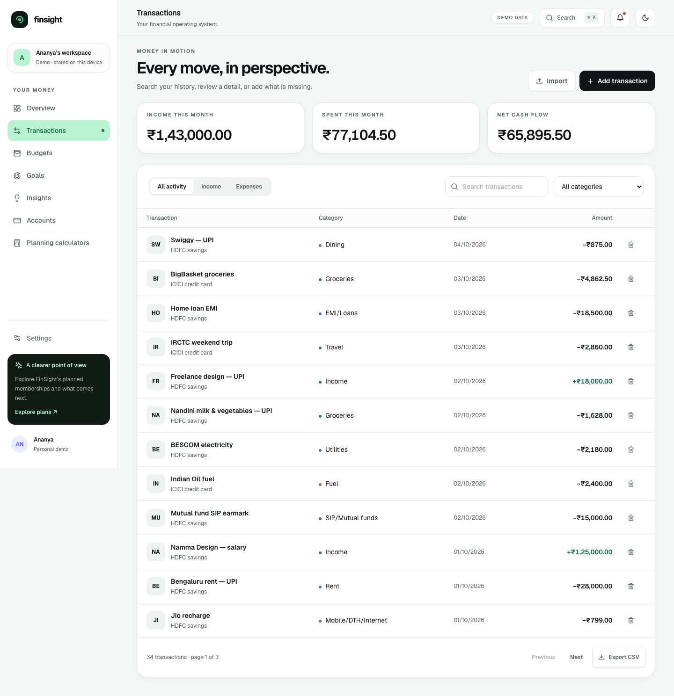
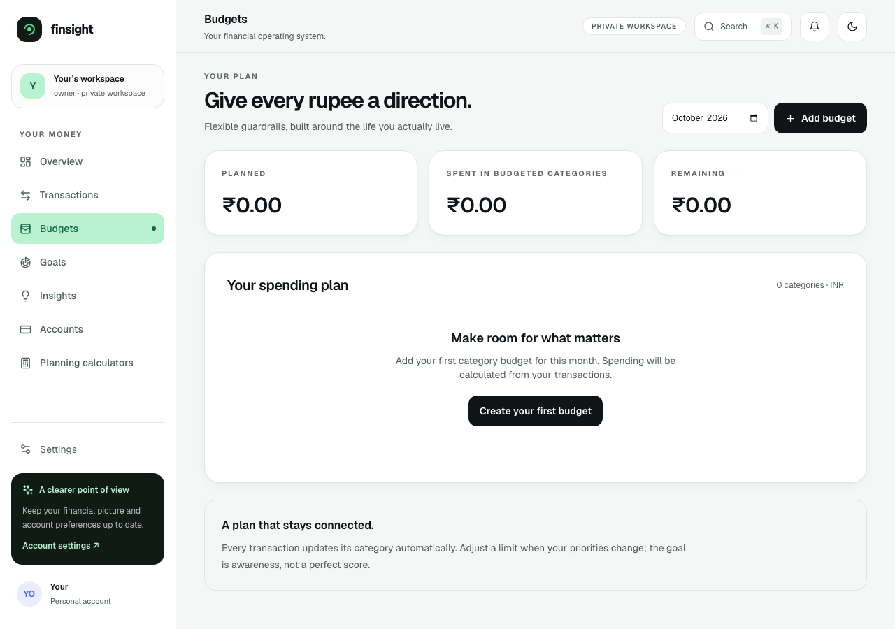
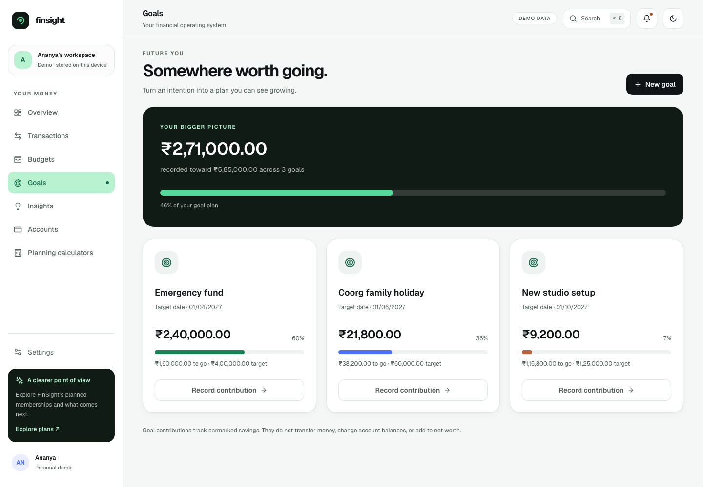
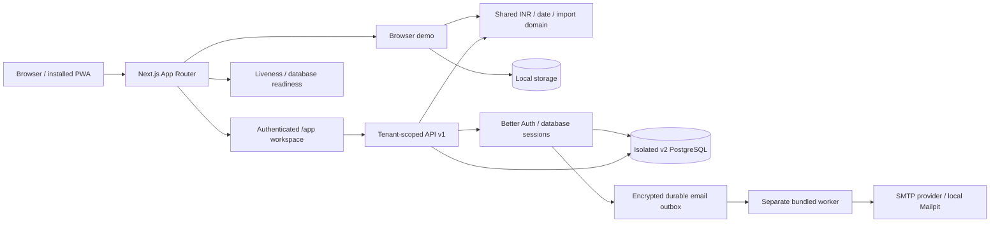

<div align="center">

# FinSight

### Money, with perspective. Built for India.

An India-first finance workspace for the everyday money moves and bigger plans that matter.
Track rupees precisely, understand your cash flow, and give the next chapter a direction.

[](package.json)
[](https://nextjs.org/)
[](package.json)
[](docs/INDIA.md)
[](.github/workflows/quality.yml)
[](#license-and-contact)

[Try v2 locally](#quick-start) · [Live site — earlier release](https://finsight-five-delta.vercel.app) · [Screenshots](#screenshots) · [Deployment](docs/DEPLOYMENT.md) · [Docs](#documentation)

</div>


**Release status · 5 October 2026:** India-first v2 is verified locally on `feat/india-inr`, including authenticated PostgreSQL workspaces, planning tools, primary-store data rights and production containers. The linked public site currently serves an earlier release. This branch has not been publicly deployed or run in GitHub CI; billing and live bank sync remain planned.

## Quick start

From the repository root, with **Node.js 22.12+** and npm:

```sh
npm ci
npm run dev
```

Open **[localhost:3000](http://localhost:3000)**, then enter the demo. No environment file, database, API keys or sign-in is needed. Ananya's fictional Bengaluru workspace includes salary, rent, groceries, UPI purchases, an EMI and a SIP allocation. Changes persist in this browser; Settings offers JSON export, restore and clear.

### Authenticated local workspaces

With Docker running and dependencies installed:

```sh
npm run dev:hosted
```

Open **[sign-up](http://localhost:3000/sign-up)** and verify your email through **[Mailpit](http://localhost:18025)**. The launcher starts isolated PostgreSQL, the email worker and the app, generates protected local auth secrets, and applies the hosted migrations. `/app` starts with empty, database-backed workspaces; it never imports the demo automatically. See [hosted setup](docs/HOSTED.md).

### Production preview

Stop the development server first:

```sh
npm run build
npm run start
```

Open **[localhost:3000](http://localhost:3000)**. The build generates both Prisma clients, the web application and the independently bundled email worker. Development and production use the same `.next` directory; rebuild after running development before production checks.

### Docker demo

Requires Docker Compose **2.20+**:

```sh
docker compose --env-file .env.example up -d --build --wait
```

Open **[localhost:3000](http://localhost:3000)**. The explicit sanitized env file selects demo mode. The app runs as a non-root standalone container, with loopback ingress, a read-only filesystem and health checks.

```sh
docker compose --env-file .env.example down
```

All executable commands in this README were run locally. Hosted containers, SMTP, release migrations and cloud promotion are covered below and in the deployment runbook.

## What you can do

| Capability                                    | Browser demo                                                                               | Authenticated hosted mode                                                                                            |
| --------------------------------------------- | ------------------------------------------------------------------------------------------ | -------------------------------------------------------------------------------------------------------------------- |
| INR accounts, transactions, budgets and goals | Local persistence, edit/delete, search and category filters                                | Real PostgreSQL records, role-checked mutations, cursor pagination                                                   |
| Cash-flow and financial-year reporting        | Dashboard, explainable score, category insights and scenarios                              | Workspace totals and April–March cash flow                                                                           |
| CSV / OFX statements                          | Validated preview, deduplication and CSV export                                            | Validated preview, server-side deduplication and CSV export                                                          |
| Indian money habits                           | Indian categories, conservative merchant suggestions, UPI references and seasonal goals    | Shared categories/import rules and seasonal goal suggestions                                                         |
| Manual account types                          | Savings, Current, Credit Card, UPI wallet, FD, RD, PPF, EPF, NPS, Gold, Mutual funds, Loan | Same manual types; no live valuation or bank connection                                                              |
| Credit-card due reminders                     | User-maintained dates and in-app notifications                                             | Persisted dates and in-workspace reminders                                                                           |
| EMI, SIP and goal planning                    | Calculators with explicit assumptions; EMI schedule CSV                                    | Same calculators at `/app/calculators`                                                                               |
| Shareable report text                         | Native share/copy of an INR financial-year summary                                         | Not connected to hosted reports                                                                                      |
| Responsive light/dark workspace               | Persisted theme, mobile navigation, command palette                                        | Responsive hosted shell; theme switch is demo-only                                                                   |
| Identity and collaboration                    | No login; browser-profile access is data access                                            | Verified email/password, reset, magic links, TOTP/recovery, passkeys, sessions, invitations and four workspace roles |
| Data control                                  | JSON export, legacy-data export, restore and clear                                         | Personal export, owner financial export, fresh-session workspace/account deletion                                    |
| Offline recovery                              | Installable PWA and recovery page                                                          | Recovery assets only; no offline financial write queue                                                               |
| Paid memberships / bank sync                  | Planned pricing; no checkout                                                               | Razorpay plan and AA interface/docs only; no live adapter                                                            |

Goal contributions **earmark existing savings**: they do not transfer money, increase account balances or inflate net worth. Account types are manual ledger containers. A SIP outflow records a cash allocation, not investment units or market performance. No external payment or bank operation is presented as successfully completed.

### India is the default

- **Money:** integer paise throughout the v2 ledger; exact rupee parsing, explicit half-up calculation rounding, `en-IN` grouping such as **₹1,25,000.00**, and lakh/crore chart labels.
- **Calendar:** `Asia/Kolkata`, **DD/MM/YYYY** displays, ISO stored dates, and **1 April–31 March** financial years.
- **Statements:** Indian or ISO dates, quoted Indian comma amounts, explicit currency in CSV exports, and rejection of declared non-INR CSV/OFX. Currency-less imports mean INR; review the preview before saving.
- **Existing records:** financially empty legacy hosted workspaces adopt INR. Funded USD workspaces retain their currency and amounts, remain exportable and reject finance writes. Earlier browser data remains available for export in Settings. No silent FX conversion.
- **Language:** English (India). Hindi/Kannada are not offered without reviewed translations.

See [the regional and migration contract](docs/INDIA.md) and [engineering/product decisions](docs/DECISIONS.md).

## Screenshots

Real Chromium captures from the **production build**, using fictional INR demo data on 5 October 2026. Local Geist/Fraunces fonts, rendered charts and Indian grouping are visible; no mocked UI or customer records. [Capture details](docs/screenshots/README.md).

<table>
  <tr>
    <td width="50%"><strong>Transactions</strong><br />Indian dates, salary, rent, UPI and statement controls.<br /><a href="docs/screenshots/transactions.png"></a></td>
    <td width="50%"><strong>Budgets</strong><br />Rupee limits and spending connected to the ledger.<br /><a href="docs/screenshots/budgets.png"></a></td>
  </tr>
  <tr>
    <td><strong>Goals</strong><br />Emergency fund, Coorg holiday and studio plans.<br /><a href="docs/screenshots/goals.png"></a></td>
    <td><strong>Dark mode</strong><br />The same cash-flow picture in the persisted dark theme.<br /><a href="docs/screenshots/dashboard-dark.png"></a></td>
  </tr>
</table>

<details>
<summary><strong>Mobile · 390 × 844, touch controls and bottom navigation</strong></summary>
<br />

</details>

## Architecture



Workspace membership is resolved server-side. Financial writes recheck roles inside serialized transactions, enforce tenant-safe foreign keys, bind idempotency to actor/request, and record audit events. Hosted errors never substitute sample records. The original Float-money schema and single-operator API remain behind a disabled legacy gate.

| Layer                | Technology                                                                          |
| -------------------- | ----------------------------------------------------------------------------------- |
| Web and domain       | Next.js 15.5.27, React 18, TypeScript, Zod                                          |
| UI                   | Tailwind CSS 3, Radix dialogs, Lucide, local Geist/Fraunces fonts                   |
| Reporting            | Lazy-loaded Recharts, integer-money pure calculations                               |
| Identity and storage | Better Auth, Prisma 5.22, PostgreSQL 16 in local containers                         |
| Email                | Nodemailer, encrypted PostgreSQL outbox, separately bundled Node worker             |
| Verification         | Vitest/V8 coverage, Playwright/Chromium, axe accessibility checks                   |
| Delivery             | Multi-stage Docker, Compose, GitHub Actions; Vercel region config and Caddy runbook |

### Repository map

```text
src/app/                 Public/demo routes, hosted /app, identity and API v1
src/components/          Finance UI, hosted UI, accessible primitives and shells
src/lib/finance/         Regional contract, ledger, imports, planning and report text
src/lib/hosted/          Sessions, tenant repository, validation, email and policies
src/lib/banking/         Provider-neutral AA boundary; no registered live adapter
prisma/hosted/           Separate hosted schema and additive release migrations
scripts/                 Local launchers, bundled worker, env generation, container smoke
tests/                   Unit, demo-browser and hosted integration/browser suites
ops/                     Caddy reverse-proxy configuration
docs/                    Decisions, API, security, deployment and screenshots
```

## Configuration

The single **[`.env.example`](.env.example)** is the full annotated reference. No variables are required for the browser demo. Local secrets live in ignored files; runtime secrets are injected into containers rather than baked into images.

| Setting                                                                  | Requirement / purpose                                                                                     |
| ------------------------------------------------------------------------ | --------------------------------------------------------------------------------------------------------- |
| `NEXT_PUBLIC_APP_URL`                                                    | Optional demo metadata origin; set the real HTTPS public origin at build time for deployment              |
| `HOSTED_ENABLED`                                                         | `false` selects demo; `true` enables authenticated PostgreSQL workspaces                                  |
| `HOSTED_DATABASE_URL`                                                    | Required hosted PostgreSQL DSN; separate from the legacy schema                                           |
| `BETTER_AUTH_URL`, `BETTER_AUTH_SECRET`                                  | Required hosted origin and independent secret of at least 32 characters; public production requires HTTPS |
| `SMTP_HOST`, `EMAIL_FROM`                                                | Required hosted SMTP server and sender; `SMTP_PORT` defaults to `587`                                     |
| `SMTP_USER`, `SMTP_PASSWORD`                                             | Provider-issued authentication pair when required; production delivery uses TLS                           |
| `PRIVACY_CONTACT_EMAIL`, `GRIEVANCE_OFFICER_NAME`                        | Required real operator details for public hosted production                                               |
| `HOSTED_LOCAL`                                                           | Loopback-only test escape hatch; `false` for a public deployment                                          |
| `TRUSTED_IP_HEADER`                                                      | Optional proxy-overwritten single-IP header; empty uses a shared fallback rate bucket                     |
| `GOOGLE_CLIENT_ID`, `GOOGLE_CLIENT_SECRET`                               | Optional provider pair; not live-verified, and new signup still requires notice acceptance                |
| `APPLE_CLIENT_ID`, `APPLE_CLIENT_SECRET`                                 | Optional provider pair with the same verification/notice boundary                                         |
| `BUILD_STANDALONE`, `NEXT_TELEMETRY_DISABLED`                            | Docker standalone build and optional telemetry control                                                    |
| `HOSTNAME`, `PORT`, `TZ`                                                 | Runtime binding/port/timezone; Docker defaults to `0.0.0.0`, `3000`, `Asia/Kolkata`                       |
| `FINSIGHT_PORT`, `FINSIGHT_IMAGE`                                        | Compose loopback port and immutable image selection                                                       |
| `FINSIGHT_DOMAIN`                                                        | Actual public hostname supplied to the separate Caddy service                                             |
| `POSTGRES_PASSWORD`                                                      | Required for the Compose hosted database; generate a fresh value                                          |
| `REDIS_PASSWORD`                                                         | Optional Redis profile only; hosted limits/outbox use PostgreSQL                                          |
| `ENABLE_LEGACY_API`                                                      | Keep `false`; enabling it is rejected at public hosted production boot                                    |
| `DATABASE_URL`, `DIRECT_URL`, `REDIS_URL`, `APP_PASSWORD`, `AUTH_SECRET` | Disabled legacy operator mode only; not the hosted ledger's credentials                                   |

Boot validation names missing/invalid variables without printing their values. Historical external credentials must be revoked in their owning providers; sanitized templates and fresh local credentials do not revoke an old password. See [security and rotation](docs/SECURITY.md).

## Verification

Run production checks after the build, with the dev server stopped:

```sh
npm run format:check
npm run check
npx playwright install chromium
E2E_PRODUCTION=1 npm run test:e2e
E2E_PRODUCTION=1 npm run test:hosted
npm audit --omit=dev --audit-level=high
docker build -t finsight:local .
npm run test:container
```

The test suites contain 26 unit tests, 9 demo browser tests and 10 hosted tests. `check` gates client generation, lint, types, coverage and the production web/worker build. Browser checks cover real mutations, persistence, imports, mobile overflow, light/dark axe scans, local rupee glyphs, identity/MFA/passkeys, tenant/role denials, concurrency, migration safety, data rights and hosted script nonces/cookie attributes.

Container smoke covers non-root demo health, invalid configuration rejection, fresh release migrations, database readiness, worker SMTP delivery/body erasure, signup/verification/INR ledger writes, and a disposable logical dump/restore with paise totals reconciled. It removes only its own smoke resources. Financial coverage thresholds are **80% lines/statements/functions and 70% branches**; they are not a full-repository coverage claim.

Runtime audit reports **zero vulnerabilities**. The full audit is deliberately shown separately:

```sh
npm audit --audit-level=high
```

It currently exits nonzero with **7 high development/build-tool findings** in the `braces` chain used by Tailwind 3 and Next ESLint. CI hard-gates runtime advisories and reports this documented exception; the complete audit is not clean. [Scope and reassessment](docs/SECURITY.md#dependency-audit-boundary).

### Useful verified scripts

| Script                                 | Purpose                                                                                |
| -------------------------------------- | -------------------------------------------------------------------------------------- |
| `dev` / `dev:hosted`                   | Browser demo / isolated local database-backed development                              |
| `build` / `start`                      | Production web/worker build / validated web startup                                    |
| `db:generate`                          | Generate both Prisma clients                                                           |
| `db:hosted:migrate`                    | Apply only hosted release migrations; local launchers run it against their isolated DB |
| `lint` / `typecheck` / `test:coverage` | Individual static and unit/coverage checks                                             |
| `format:check` / `check`               | Formatting check / aggregate release verification                                      |
| `test:e2e` / `test:hosted`             | Demo / authenticated production browser and integration workflows                      |
| `env:init` / `test:container`          | Fresh protected local configuration / disposable container release smoke               |

## Deployment

Two documented paths share the same migrations, web/worker artifacts and smoke contract:

1. **Vercel web in Mumbai + Neon + separate Mumbai worker.** Source-checked guidance includes origins/HTTPS, pooled versus migration DSNs, SES, retention and rollback. Neon currently has no Mumbai region: using Singapore is **not India-only residency**.
2. **Docker VPS / AWS Mumbai.** Caddy HTTPS, loopback-only app, private PostgreSQL/RDS, release migration job, separate worker, SES, encrypted backups and schema-compatible rollback.

Both are in **[the deployment runbook](docs/DEPLOYMENT.md)**. Public provisioning, certificate issuance, production SMTP approval and cloud PITR drills are pending external operations.

For the verified **local hosted-container rehearsal**:

```sh
npm run env:init -- --mode hosted --output .local/docker.env
docker compose --env-file .local/docker.env -f compose.yaml -f compose.smoke.yaml --profile hosted up -d --build --wait
```

Open **[localhost:3302/sign-up](http://localhost:3302/sign-up)**; email arrives at **[localhost:18026](http://localhost:18026)**. The generator creates fresh mode-0600 credentials and refuses to overwrite an existing file; run it once and reuse the protected file for subsequent rehearsals. This is a loopback test with Mailpit. Public delivery uses the base Compose file, actual domain/operator settings and verified SMTP.

```sh
docker compose --env-file .local/docker.env -f compose.yaml -f compose.smoke.yaml --profile hosted down
```

Stopping this rehearsal retains its database volume. `/api/health` checks liveness; `/api/ready` checks hosted database access. SMTP and backups need separate checks.

## Privacy and data rights

New hosted signups require privacy-notice acceptance, recorded server-side with its version and timestamp. `/app/security` offers personal export and account deletion; workspace owners export/delete financial workspaces. Deletion requires a fresh sign-in and exact confirmation, and account deletion is blocked while owning workspaces. Authentication secrets are excluded from personal exports.

Primary-store operations support an India-first DPDP notice and rights workflow. Delivered mail, exported files, processor logs and encrypted backups still need operator retention/deletion policy, a real grievance channel and legal review. This is not a compliance certification. Demo storage is unencrypted and has no remote backup; export before clearing it. Hosted/auth pages use nonced script CSP and no-store, and the service worker caches only recovery assets.

## Roadmap

Planned work, with no delivery dates or live integration claims:

- Deploy the current demo and measure real-device performance.
- Add approved Razorpay checkout, GST invoices and server-enforced entitlements.
- Implement a sandbox-verified Account Aggregator adapter with consent/revocation.
- Validate production SMTP/OAuth and complete processor retention/legal operations.
- Add observability, cloud restore drills and versioned outbox-key rotation.

Deliberate exclusions and their rationale are in [DECISIONS](docs/DECISIONS.md).

## Contributing

Open a focused issue or pull request with the user-visible change and evidence. Preserve integer-money invariants, tenant boundaries and applied migrations; add additive migrations for schema changes. Provide a representative fixture before claiming a bank format is supported. Verify the commands above and include meaningful regression coverage for financial/security changes; use fictional records in screenshots.

## Documentation

| Guide                                                           | Contents                                                  |
| --------------------------------------------------------------- | --------------------------------------------------------- |
| [India](docs/INDIA.md) / [Decisions](docs/DECISIONS.md)         | Money/calendar/migration contract and engineering choices |
| [Hosted](docs/HOSTED.md) / [API](docs/API.md)                   | Local identity/workspaces and authenticated API v1        |
| [Deployment](docs/DEPLOYMENT.md) / [Security](docs/SECURITY.md) | Operational paths, threat model, secrets and audits       |
| [Account Aggregator](docs/ACCOUNT_AGGREGATOR.md)                | Provider boundary and prerequisites; no live sync         |

## License and contact

The repository currently has **no declared license or LICENSE file**; no MIT/Apache permission is implied by its public visibility.

Maintainer: **[Thippeswamy · @Thippeswamykr1204](https://github.com/Thippeswamykr1204)**. Use **[GitHub issues](https://github.com/Thippeswamykr1204/FinSight/issues)** for bugs and product discussions. For vulnerabilities, follow the private-reporting guidance in [SECURITY](docs/SECURITY.md).
