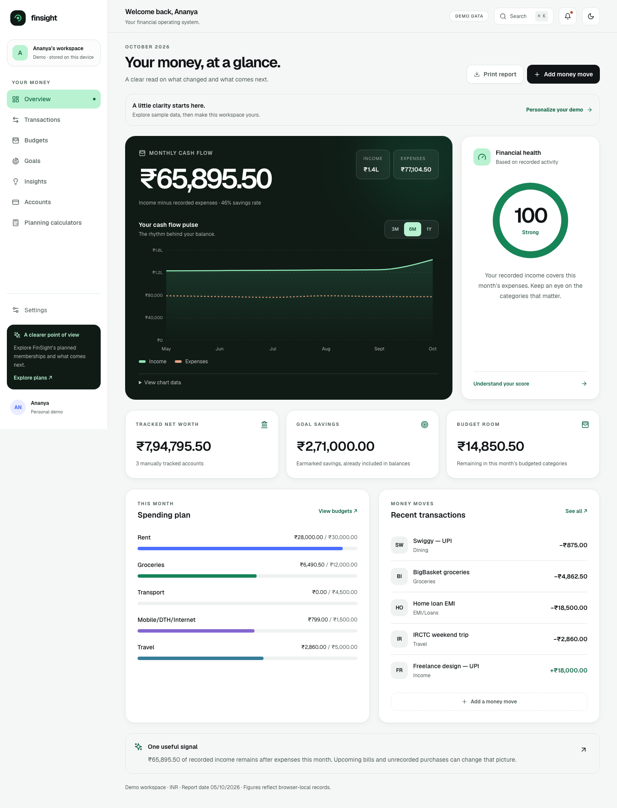
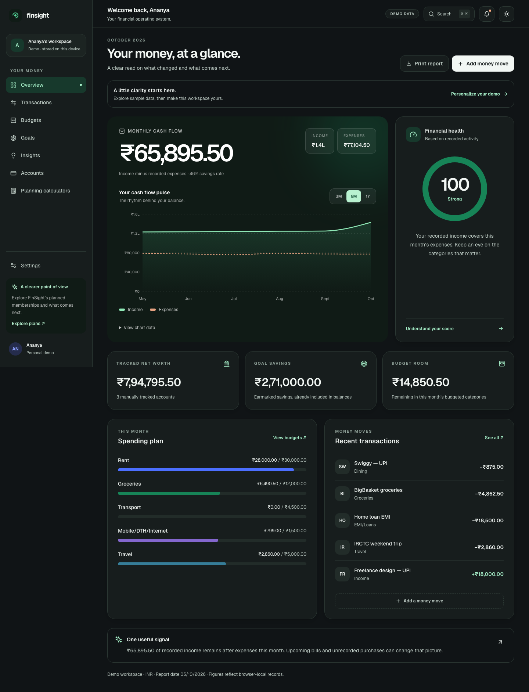
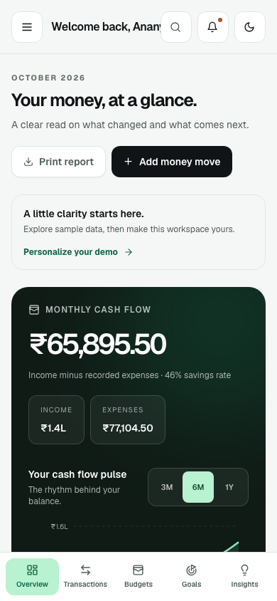
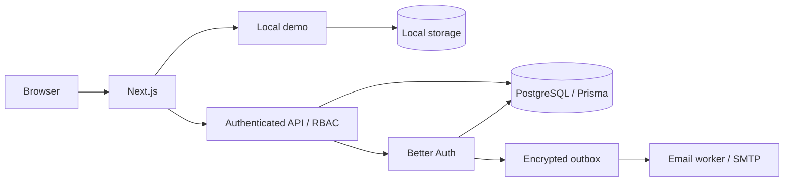

<div align="center">

# FinSight

### Money, with perspective.

An India-first personal finance workspace with precise rupee accounting and authenticated, multi-tenant PostgreSQL storage.

[](https://nextjs.org/)
[](https://www.typescriptlang.org/)
[](https://www.postgresql.org/)
[](package.json)
[](LICENSE)

[Live demo — earlier release](https://finsight-five-delta.vercel.app) · [Docs](#documentation) · [Deploy](docs/DEPLOYMENT.md)

</div>

The public demo currently serves an earlier release. The implementation documented here is tested locally; current-version deployment is planned.

<table>
  <tr>
    <th>Dashboard</th>
    <th>Dark mode</th>
    <th>Mobile</th>
  </tr>
  <tr>
    <td><a href="docs/screenshots/dashboard.png"></a></td>
    <td><a href="docs/screenshots/dashboard-dark.png"></a></td>
    <td><a href="docs/screenshots/dashboard-mobile.png"></a></td>
  </tr>
</table>

Actual browser captures with fictional INR records. [More screens and capture settings](docs/screenshots/README.md).

## Why FinSight

Indian grouping, Kolkata dates and April–March reports are built into the domain.
Money uses integer paise, with exact rupee parsing and explicit rounding.
Hosted records belong to role-controlled workspaces, enforced in the API and database.
A separate browser demo makes the project easy to explore without credentials.

## Features

**Live** means implemented and exercised locally, not publicly deployed SaaS.
The browser demo and authenticated `/app` workspace use separate storage.

| Capability                                                   | Scope                                                     | Status    |
| ------------------------------------------------------------ | --------------------------------------------------------- | --------- |
| Accounts, transactions, budgets and savings goals            | Browser-local and PostgreSQL workspaces                   | Live      |
| INR/paise, Indian dates and financial-year summaries         | Shared finance domain                                     | Live      |
| CSV/OFX preview, validation, deduplication and export        | Demo and hosted statements                                | Live      |
| Indian account types and card due reminders                  | Manual tracking; no bank/payment detection                | Live      |
| EMI, SIP and goal calculators                                | Explicit assumptions; EMI schedule CSV                    | Live      |
| Passkeys, TOTP, magic links and session controls             | Authenticated identity                                    | Live      |
| Invitations, four roles, audit and personal/workspace rights | Hosted workspaces                                         | Live      |
| Cash-flow charts, score, scenarios and report sharing        | Browser demo                                              | Demo-only |
| Persisted light/dark theme and command palette               | Browser demo                                              | Demo-only |
| Razorpay billing, paid entitlements and bank sync            | Approvals and verified adapters required                  | Planned   |
| Google/Apple provider login                                  | Configuration adapters exist; external validation pending | Planned   |

Goal contributions earmark existing savings; they do not transfer money or increase net worth.
FD/PPF/EPF/NPS/Gold/Mutual-fund accounts are manual containers, not valuation engines.
Funded legacy USD workspaces remain exportable/read-only; no silent FX conversion.

## Quick start

### Demo in one minute

Requires **Node.js 22.12+** and npm. From the repository root:

```sh
npm ci
npm run dev
```

Open **[localhost:3000](http://localhost:3000)** and enter the demo.
No environment file, database, API key or sign-in is required.
Changes stay in this browser; Settings provides JSON export, restore and clear.

### Hosted mode with Docker

With Docker running and dependencies installed, stop the demo server and run:

```sh
npm run dev:hosted
```

Create an account at **[localhost:3000/sign-up](http://localhost:3000/sign-up)**.
Verification mail arrives in **[Mailpit](http://localhost:18025)**.
The launcher starts isolated PostgreSQL, migrations, the email worker and Next.js.
Authenticated `/app` workspaces start empty; demo data is never imported automatically.
[Hosted setup and persistence](docs/HOSTED.md).

### Production preview

Stop development first; both modes use `.next`:

```sh
npm run build
npm run start
```

## Architecture



- **Web:** Next.js 15 App Router, React 18, TypeScript and Zod.
- **UI:** Tailwind CSS, Radix, Recharts and local Geist/Fraunces fonts.
- **Data:** Prisma 5.22, PostgreSQL BIGINT money and additive migrations.
- **Identity:** Better Auth; durable Nodemailer outbox and bundled worker.
- **Quality/delivery:** Vitest, Playwright, axe, Docker/Compose and GitHub Actions configuration.

## Engineering highlights

- **Integer-paise model:** exact decimal parsing, bounded arithmetic, SQL constraints and deliberate rounding.
- **Tenant isolation:** server-resolved membership, owner/admin/editor/viewer RBAC and composite tenant/account foreign keys.
- **Reliable writes:** actor-bound idempotency, atomic audit records and optimistic transaction versions.
- **Identity:** verified email, passkeys, confirmed TOTP/recovery, single-use magic links and session revocation.
- **Browser hardening:** hosted/auth script nonces, strict-dynamic CSP, no-store responses and HttpOnly/SameSite cookies; Secure on HTTPS.
- **DPDP-aware controls:** recorded notice acceptance, secret-free personal export and fresh-session owner/account deletion.
- **Verification:** 26 unit tests, 9 demo and 10 hosted production tests; accessibility, money migration, isolation and container restore coverage.

Primary-store deletion does not erase previously downloaded exports, delivered mail or backups.
The PWA caches recovery assets only. Demo storage is unencrypted; hosted financial responses are not cached.
Operational boundaries and the dependency exception are in [SECURITY](docs/SECURITY.md).

## Scripts and environment

| Script                     | Purpose                                                 |
| -------------------------- | ------------------------------------------------------- |
| `dev` / `dev:hosted`       | Browser demo / isolated hosted development              |
| `build` / `start`          | Production web/worker build / validated web startup     |
| `check`                    | Client generation, lint, types, unit coverage and build |
| `test:e2e` / `test:hosted` | Demo / hosted browser and integration suites            |
| `test:container`           | Disposable Docker migrations, SMTP and restore smoke    |
| `db:hosted:migrate`        | Hosted release migrations only                          |

The annotated **[`.env.example`](.env.example)** is the configuration reference.
Hosted mode needs its own database, origin, auth secret and SMTP; public production also requires operator privacy details.
Never use the legacy schema/seed for hosted records or commit real environment files.

## Testing

With the development server stopped and Docker running:

```sh
npm run format:check
npm run check
npx playwright install chromium
E2E_PRODUCTION=1 npm run test:e2e
E2E_PRODUCTION=1 npm run test:hosted
npm audit --omit=dev --audit-level=high
docker build -t finsight:local .
npm run test:container
```

The test runners manage their servers and isolated hosted dependencies.
Finance coverage gates are 80% lines/statements/functions and 70% branches, not whole-repository coverage.
The Quality workflow configures these gates; no green GitHub run is claimed.
Runtime audit has zero findings; the full audit has 7 high build-tool findings documented in [SECURITY](docs/SECURITY.md#dependency-audit-boundary).

## Deployment

[DEPLOYMENT](docs/DEPLOYMENT.md) covers a no-database demo, Vercel/Neon plus a separate worker, and Docker/AWS Mumbai.
It includes HTTPS, migrations, SMTP, backups and rollback.
Neon Singapore plus Vercel Mumbai is not India-only residency.

## Roadmap

Planned work; no delivery dates or live integration claims:

- Deploy the current demo and measure real-device performance.
- Add approved Razorpay checkout, GST invoices and server-enforced entitlements.
- Implement a sandbox-verified Account Aggregator adapter with consent/revocation.
- Validate production SMTP/OAuth and complete processor retention/legal operations.
- Add observability, cloud restore drills and versioned outbox-key rotation.

## Documentation

[API](docs/API.md) · [Hosted](docs/HOSTED.md) · [India](docs/INDIA.md) · [Decisions](docs/DECISIONS.md) · [Security](docs/SECURITY.md) · [Account Aggregator](docs/ACCOUNT_AGGREGATOR.md)

## License

[MIT](LICENSE) · Copyright © 2026 Thippeswamy.

## Author

**[Thippeswamy](https://github.com/Thippeswamykr1204)** · [Repository](https://github.com/Thippeswamykr1204/FinSight) · [Issues](https://github.com/Thippeswamykr1204/FinSight/issues)

For contributions, see [CONTRIBUTING](CONTRIBUTING.md).
