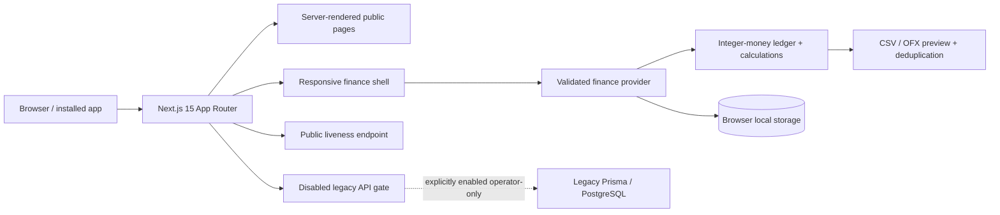

# FinSight v2

**Money, with perspective.** A premium, responsive finance workspace with a working browser-local demo.

> Current status: product-core milestone, not a hosted commercial SaaS. Authentication, multi-tenant persistence, Stripe billing, live bank sync and production infrastructure are still pending. See [PROGRESS](docs/PROGRESS.md) for the exact continuation point.

## Run it

Requires Node.js **22.12+**. Install dependencies once with `npm ci`, then:

```sh
npm run dev
```

Open **http://localhost:3000**. No environment file, database, API keys or sign-in is required for the demo. The landing page leads into a fictional workspace. Changes are stored in browser local storage and persist across reloads.

For a production-mode local preview, run `npm run build` then `npm run start`. With a running Docker daemon, `docker compose up --build` builds the standalone demo container. The Docker configuration has been validated, but the image was not built in this environment because its daemon was stopped.

## What works

- Premium light/dark design tokens, local Geist/Fraunces fonts, responsive sidebar and mobile navigation.
- Dashboard: reconciled cash flow, net worth, budget room, financial health and lazy-loaded comparative charts.
- Transactions: add/edit/delete, search, type/category filters, pagination, CSV export.
- CSV and OFX import: validation, preview, file/row limits and account-scoped duplicate detection.
- Monthly category budgets with live spend calculations and over-budget states.
- Goals with persisted contributions and completion feedback; manual cash/credit/investment accounts.
- Explainable financial score, category drill-down and cash-flow scenario with explicit assumptions.
- Onboarding, keyboard command palette (`Cmd/Ctrl+K`), in-app notifications, locale formatting, JSON export and local data clearing.
- Marketing, planned pricing, features, FAQ, preview privacy/terms, sitemap, Open Graph and install manifest.
- Production service worker with offline recovery; financial pages and API responses are not cached.
- Unit tests, coverage gates, Playwright workflows, axe accessibility checks and runtime dependency scanning.

All ledger amounts use integer minor units. The demo uses USD; selecting a locale changes formatting, not exchange rates. Goal contributions earmark existing savings and do not transfer money or inflate net worth. No payment, bank connection, email or AI request is simulated as a successful live operation.

## Architecture



The new finance domain is in `src/lib/finance/`; shared state and accessible dialog/form primitives are in `src/components/finance/`. Pages consume the same ledger so mutations recalculate related views. Original server helpers/schema are preserved for reference behind the disabled legacy API; they are not a tenant-safe v2 backend.

### Decisions

- Retain Next/React/TypeScript instead of a framework rewrite; upgrade vulnerable Next 14 to 15.5.27.
- Use Turbopack for development after a webpack dev cold-start hydration failure was observed.
- Own the token layer rather than adding an opaque theme dependency.
- Use local font packages to avoid external font downloads during build/runtime.
- Build an explicit demo, rather than silently replacing failed database reads with invented data.
- Use integer minor units, shared Zod schemas and pure calculations to make financial invariants testable.
- Keep commercial functionality visibly pending until real integrations and isolation are verified.

## Environment

`.env.example` contains safe local defaults; `.env` is ignored. No variables are required for the demo.

| Variable | Purpose |
|---|---|
| `NEXT_PUBLIC_APP_URL` | Public origin for metadata and sitemap; set at build time |
| `BUILD_STANDALONE` | Set to `true` in the Docker build to produce the standalone runtime |
| `ENABLE_LEGACY_API` | Defaults to disabled. Do not enable for a public SaaS deployment |
| `DATABASE_URL`, `DIRECT_URL` | Legacy PostgreSQL connections only |
| `REDIS_URL` | Legacy optional cache only |
| `APP_PASSWORD`, `AUTH_SECRET` | Legacy single-operator API access; signing secret must be at least 32 characters |

The original env template contained credentials. Current values are sanitized; historical values must be rotated in the owning services before those environments are reused. See [security](docs/SECURITY.md).

## Verification

```sh
npm run lint
npm run typecheck
npm run test:coverage
npm run build
npx playwright install chromium
npm run test:e2e
E2E_PRODUCTION=1 npm run test:e2e
```

Run production-mode browser checks after `npm run build` and before running the dev server again; both Next modes use `.next`. The browser runner manages its own server on port 3100. `npm run format:check` checks source formatting; `npm audit --omit=dev --audit-level=high` gates runtime dependencies. Financial-domain coverage thresholds are 80% lines/statements/functions and 70% branches; they do not claim full UI coverage.

The automated browser suite covers transaction mutation/persistence, import deduplication, budgets/goals/accounts, onboarding/preferences/data clearing, command palette, public routes, light/dark accessibility, mobile overflow and disabled API security. See [PROGRESS](docs/PROGRESS.md) for the latest verified counts and limitations.

## Documentation

- [Original review](docs/REVIEW.md)
- [Build plan and target architecture](docs/BUILD_PLAN.md)
- [Progress and next steps](docs/PROGRESS.md)
- [Deployment and runbooks](docs/DEPLOYMENT.md)
- [Security and threat model](docs/SECURITY.md)
- [Launch checklist, economics, scale costs and 90-day roadmap](docs/LAUNCH.md)

## Demo data

The demo seeds itself on first visit using the current calendar month. Settings can restore fictional data or clear the workspace. Export before clearing browser storage. The legacy `prisma/seed.ts` is unrelated to the browser demo and must not be run against a production database.
