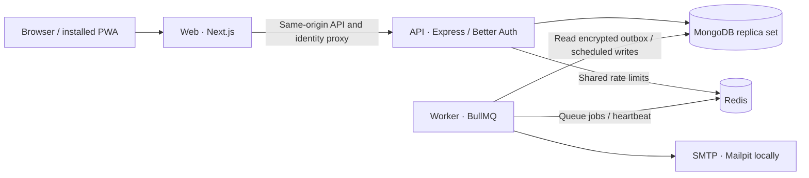

<div align="center">
  <h1>FinSight</h1>
  <p><strong>Money, with perspective.</strong></p>
  <p>An India-first personal finance workspace for accounts, spending, and savings.<br />Built around exact paise, Indian number formatting, and a financial year that starts in April.</p>
  <p>
    <a href="package.json"></a>
    <a href="LICENSE"></a>
    <a href="https://github.com/Thippeswamykr1204/FinSight/actions/workflows/quality.yml"></a>
    <a href="package.json"></a>
    <a href="package.json"></a>
    <a href="compose.yaml"></a>
    <a href="compose.yaml"></a>
  </p>
</div>

## Contents

[Overview](#overview) · [Features](#features) · [Tech stack](#tech-stack) ·
[Architecture](#architecture) · [Quick start](#quick-start) ·
[Environment](#environment-variables) · [Scripts and quality](#scripts-testing-and-quality) ·
[Deployment](#deployment) · [Security](#security-and-privacy) ·
[Documentation](#documentation) · [Contributing](#contributing) · [License](#license)

## Overview

FinSight brings manually maintained accounts, transactions, budgets, and savings
goals into a private, server-backed workspace. It is for people tracking their
own finances and small groups sharing records through role-controlled access.
New workspaces start empty; insights are calculated from the activity you record.

India-first conventions are part of the shared domain, not just display settings:

| Convention       | Implementation                                                                                                                                |
| ---------------- | --------------------------------------------------------------------------------------------------------------------------------------------- |
| Exact money      | Integer paise throughout the ledger: ₹123.45 is stored as `12345`. Decimal input is parsed with BigInt before conversion to bounded integers. |
| Familiar numbers | INR and `en-IN` grouping, including `₹1,00,000`; compact charts/cards use lakh (`L`) and crore (`Cr`).                                        |
| Local dates      | `Asia/Kolkata` (IST), ISO calendar dates in storage, and `DD/MM/YYYY` in the interface.                                                       |
| Financial year   | April 1–March 31, with financial-year cash-flow summaries.                                                                                    |

Accounts use opening balances plus recorded income and expenses. Goal
contributions earmark savings without transferring money. EMI, SIP, and goal
calculators show their assumptions and produce estimates.


## Features

### Finance

- **Accounts:** manual savings, current, credit-card, UPI-wallet, deposit, investment,
  and loan accounts; opening balances and credit-card due-date reminders.
- **Transactions:** create, edit, delete, search, filter, and export CSV records,
  with account-linked balances and version checks on edits.
- **Budgets and goals:** monthly category limits, overspending indicators, target
  dates, and recorded savings contributions.
- **Insights:** cash-flow charts, category breakdowns, an explainable planning
  score, financial-year totals, and 3/6/12-month cash-flow scenarios.
- **Calculators:** EMI amortization with schedule CSV download, SIP projections,
  and monthly savings needed for a goal.
- **Statement import:** CSV and OFX preview, validation, duplicate detection,
  Indian dates/amounts, category suggestions, and INR currency checks.
- **Recurring records and reports:** scheduled daily/weekly/monthly/yearly
  transactions and revocable, seven-day shared summary reports on Pro/Business;
  dashboard reports can be printed.

### Security and Privacy

- Verified-email/password authentication, password reset with session revocation,
  passkeys, TOTP with recovery codes, and single-use magic links.
- Session/device review and remote sign-out; optional Google login when both
  provider credentials are configured.
- Password visibility toggles on sign-in, sign-up, new-password, and current-password
  fields, with keyboard access and screen-reader labels.
- Personal-data JSON export, owner-only workspace JSON export, workspace deletion,
  and account deletion with recent-sign-in and explicit-confirmation checks.
- Server-enforced tenant boundaries, shared rate limits, and encrypted email
  bodies and billing-party details.

### Collaboration

- Private workspaces with **Owner, Admin, Editor, and Viewer** roles enforced by the API.
- Email invitations with expiring, single-use acceptance and invitation revocation;
  member removal and owner-controlled role changes.
- Workspace switching and plan-based seat limits. Business adds owner/admin access
  to the workspace audit log.

### Billing

- Free operation without payment credentials; optional Razorpay subscriptions for
  Pro and Business, with server-enforced workspace, seat, and transaction limits.
- Validated Indian billing details and optional recipient GSTIN; GST invoice
  downloads, distinctly labelled test receipts, and verified paid-period access.
- Checkout recovery, next-cycle plan changes where supported by the payment method,
  cancellation, signed webhooks, and background reconciliation.

Paid subscriptions belong to the payer and cover their owned workspaces.
Pro enables recurring rules and shared reports; Business also enables audit-history
access. See [billing](docs/BILLING.md) for prices, quotas, and payment-method constraints.

### Experience

- Responsive navigation, command palette, in-app budget/payment-reminder notifications,
  and persisted light/dark workspace themes.
- Installable PWA with an offline recovery page. Its service worker caches recovery
  assets, not financial pages, API responses, or imported statements.
- Local Geist and Fraunces fonts, design tokens, visible focus states, and
  reduced-motion support.

## Tech stack

Dependency ranges below are declared in the root [package.json](package.json).
Workspace manifests reference `@finsight/shared` at `3.0.0`; the root lockfile
resolves installed versions.

| Layer                | Technology                            | Declared version/range           |
| -------------------- | ------------------------------------- | -------------------------------- |
| Runtime and language | Node.js · TypeScript                  | `>=22.12.0` · `^5`               |
| Web                  | Next.js App Router · React            | `^15.5.27` · `^18`               |
| Interface            | Tailwind CSS · Radix Dialog · Lucide  | `^4.3.3` · `^1.0.5` · `^0.344.0` |
| Charts               | Recharts                              | `^2.12.2`                        |
| API and validation   | Express · Zod                         | `^5.1.0` · `^4.6.5`              |
| Identity             | Better Auth · Passkey plugin · Argon2 | `^1.7.7` · `^1.7.7` · `^0.44.0`  |
| Database clients     | Mongoose · MongoDB driver             | `^8.19.1` · `^6.20.0`            |
| Queues and cache     | BullMQ · ioredis                      | `^5.58.5` · `^5.3.2`             |
| Email and logging    | Nodemailer · Pino                     | `^10.0.14` · `^10.0.0`           |
| Testing              | Vitest · Playwright · Testcontainers  | `^5.0.3` · `^1.63.0` · `^12.2.0` |
| Quality              | ESLint · Prettier                     | `^8` · `^3.9.9`                  |

Local Compose runs MongoDB `8`, Redis `7-alpine`, and Mailpit `v1.27`.

## Architecture



The web owns presentation and proxy routing. The API owns identity, authorization,
and persistence. The worker delivers outbox email, executes recurring records,
and reconciles billing. Shared code owns finance calculations and Zod contracts.
Ledger mutations combine replica-set transactions, workspace revisions,
actor/payload-bound idempotency, and audit events.

| Location                        | Responsibility                                                                   |
| ------------------------------- | -------------------------------------------------------------------------------- |
| `apps/web/`                     | Next.js routes, React components, themes, PWA assets, and same-origin proxy      |
| `apps/api/`                     | Express, Better Auth, Mongoose models, services, worker, and API tests           |
| `packages/shared/`              | INR arithmetic, calendars, calculators, imports, billing rules, and contracts    |
| `tests/unit/` · `tests/e2e/`    | Shared-domain tests and Playwright browser flows                                 |
| `scripts/`                      | Environment initialization, web startup, E2E orchestration, and field rekeying   |
| `docs/`                         | Domain, architecture, API, security, deployment, and presentation captures       |
| `ops/`                          | Caddy HTTPS reverse-proxy configuration                                          |
| `.github/workflows/quality.yml` | Quality checks, browser verification, and container smoke tests                  |
| Root deployment files           | Separate web/API Dockerfiles, Compose, Render, Railway, and Vercel configuration |

## Quick start

### Prerequisites

- **Node.js 22.12.0 or newer** and npm.
- **Docker with Compose v2**, running locally. MongoDB must support replica-set
  transactions; the supplied Compose configuration initializes a local replica set.

### 1. Clone and install

```sh
git clone https://github.com/Thippeswamykr1204/FinSight.git
cd FinSight
npm ci
```

### 2. Generate local configuration

```sh
npm run env:init
```

This creates a private `.env` from [.env.example](.env.example), with independently
generated authentication and field-encryption secrets. It refuses to overwrite an
existing `.env`; keep existing local settings if you already have one.

### 3. Start the full stack

```sh
docker compose up --build -d --wait
```

| Open                                                        | Purpose                                                                 |
| ----------------------------------------------------------- | ----------------------------------------------------------------------- |
| [localhost:3000/sign-up](http://localhost:3000/sign-up)     | Create an account, verify its email, and onboard an empty workspace     |
| [localhost:8025](http://localhost:8025)                     | Mailpit inbox for verification, reset, magic-link, and invitation email |
| [localhost:4000/health](http://localhost:4000/health)       | API liveness                                                            |
| [localhost:4000/ready](http://localhost:4000/ready)         | MongoDB/Redis readiness                                                 |
| [localhost:3000/api/ready](http://localhost:3000/api/ready) | Readiness through the web proxy                                         |

Stop with `docker compose down`. Named MongoDB volumes persist; `docker compose
down -v` intentionally erases local data.

### 4. Develop with live reload

After the full stack is running, stop its web/API containers and run those processes
from source. MongoDB, Redis, Mailpit, and the email worker remain available:

```sh
docker compose stop web api
npm run shared:build
npm run dev:hosted
```

The web remains at `http://localhost:3000`, and the API at `http://localhost:4000`.
For separate terminals, use `npm run dev` and `npm run dev:api`. Rebuild shared code
with `npm run shared:build` after editing `packages/shared`.

## Environment variables

[.env.example](.env.example) is the complete configuration template. Defaults below
refer to that file. API/worker configuration is validated at startup; local defaults
are supplied for convenience, while production requires explicit store credentials
and public operator settings.

### Core services and required secrets

| Variables                         | Requirement                                  | Purpose / local example                                                                                             |
| --------------------------------- | -------------------------------------------- | ------------------------------------------------------------------------------------------------------------------- |
| `BETTER_AUTH_SECRET`              | **Required in every API/worker environment** | Generated secret, at least 32 characters; `env:init` generates 48 random bytes encoded as base64url                 |
| `FIELD_ENCRYPTION_KEY`            | **Required in every API/worker environment** | Independent, nonzero 32-byte key encoded as 64 hex characters                                                       |
| `MONGODB_URI`                     | Required explicitly in production            | Replica-set URI; local template uses `mongodb://localhost:27017/finsight?replicaSet=rs0`                            |
| `REDIS_URL`                       | Required explicitly in production            | Shared limits and BullMQ; `redis://localhost:6379`                                                                  |
| `NEXT_PUBLIC_APP_URL` · `API_URL` | Required for production web configuration    | Public web URL and server-side API destination; `http://localhost:3000` / `http://localhost:4000`                   |
| `WEB_ORIGIN` · `API_ORIGIN`       | Configure for deployment                     | Trusted web/API origins; public production web origin must use HTTPS                                                |
| `NODE_ENV` · `HOSTED_LOCAL`       | Configure for deployment                     | Local: `development` / `true`; public production: `production` / `false`. Local mode requires a loopback web origin |
| `API_HOST` · `API_PORT`           | Optional local defaults                      | `0.0.0.0` / `4000`; API falls back to platform `PORT` when `API_PORT` is absent                                     |
| `HOSTNAME` · `PORT`               | Optional web runtime defaults                | Standalone web bind address/port: `0.0.0.0` / `3000`                                                                |
| `TZ` · `NEXT_TELEMETRY_DISABLED`  | Optional runtime settings                    | `Asia/Kolkata` / `1`; finance date handling also explicitly uses IST                                                |
| `FIELD_ENCRYPTION_PREVIOUS_KEYS`  | Optional rotation setting                    | JSON array of retained old keys; `[]`, maximum ten keys                                                             |
| `TRUSTED_PROXY`                   | Optional ingress setting                     | Explicit comma-separated address/subnet allowlist; blank trusts no proxy                                            |
| `LOG_LEVEL`                       | Optional                                     | `info`; API configuration accepts fatal/error/warn/info/debug/trace                                                 |

### Email and public operator details

| Variables                                          | Requirement                                        | Purpose / local example                                                    |
| -------------------------------------------------- | -------------------------------------------------- | -------------------------------------------------------------------------- |
| `SMTP_HOST` · `SMTP_PORT`                          | Configure for email delivery                       | `localhost` / `1025`; Compose directs the worker to Mailpit                |
| `SMTP_USER` · `SMTP_PASSWORD`                      | Optional credentials                               | Blank locally; a password is required when a username is supplied          |
| `EMAIL_FROM`                                       | Configure sender identity                          | `FinSight Local <hello@finsight.local>`; use a verified sender when hosted |
| `PRIVACY_CONTACT_EMAIL` · `GRIEVANCE_OFFICER_NAME` | **Required for public production API/worker boot** | Also configure the web to display the operator's contact details           |

### Optional integrations

| Variables                                                                                                     | Requirement                      | Purpose                                                                               |
| ------------------------------------------------------------------------------------------------------------- | -------------------------------- | ------------------------------------------------------------------------------------- |
| `GOOGLE_CLIENT_ID` · `GOOGLE_CLIENT_SECRET`                                                                   | Optional; configure both         | Enables Google login; redirect URI is `${WEB_ORIGIN}/api/identity/callback/google`    |
| `RAZORPAY_KEY_ID` · `RAZORPAY_KEY_SECRET` · `RAZORPAY_WEBHOOK_SECRET`                                         | Optional complete billing group  | Test/live provider credentials and a distinct webhook secret                          |
| `RAZORPAY_PRO_PLAN_ID` · `RAZORPAY_BUSINESS_PLAN_ID`                                                          | Required when billing is enabled | Distinct monthly INR plans: `35282` / `94282` paise, including 18% GST                |
| `BILLING_BUSINESS_NAME` · `BILLING_BUSINESS_ADDRESS` · `BILLING_GSTIN` · `BILLING_STATE_CODE` · `BILLING_SAC` | Required when billing is enabled | Actual supplier identity, matching GSTIN/state, and six-digit service accounting code |
| `RAZORPAY_WEBHOOK_PREVIOUS_SECRET`                                                                            | Optional rotation setting        | Retains webhook verification during the provider retry window                         |
| `SENTRY_DSN` · `SENTRY_RELEASE`                                                                               | Optional                         | Redacted server-only error monitoring and release identifier                          |

Leave the entire billing group blank for Free-only operation. Partial Google or
billing configuration fails startup. Provider secrets belong to the API/worker;
the web discovers availability from `/api/v1/capabilities`.

### Compose settings

| Variables                                      | Default in `.env.example` | Purpose                                                                                                 |
| ---------------------------------------------- | ------------------------- | ------------------------------------------------------------------------------------------------------- |
| `FINSIGHT_WEB_PORT` · `FINSIGHT_API_PORT`      | `3000` / `4000`           | Loopback host ports                                                                                     |
| `FINSIGHT_MONGO_PORT` · `FINSIGHT_REDIS_PORT`  | `27017` / `6379`          | Local store host ports                                                                                  |
| `FINSIGHT_SMTP_PORT` · `FINSIGHT_SMTP_UI_PORT` | `1025` / `8025`           | Mailpit SMTP and inbox host ports                                                                       |
| `FINSIGHT_IMAGE`                               | `finsight-web:local`      | Template image label; the current Compose files build from Dockerfiles and do not consume this variable |

Keep `.env` private. For retained-key decryption and resumable rekeying, see
[key rotation](docs/KEY_ROTATION.md).

## Scripts, testing, and quality

Run commands from the repository root; all workspaces share one lockfile.

| Command                                        | Purpose                                                                                                  |
| ---------------------------------------------- | -------------------------------------------------------------------------------------------------------- |
| `npm run dev` · `npm run dev:web`              | Next.js development; root `dev` also builds shared code through `predev`                                 |
| `npm run dev:api` · `npm run dev:hosted`       | API live reload / concurrent API and root web development                                                |
| `npm run shared:build` · `npm run shared:test` | Build shared contracts / finance, India, and planning tests                                              |
| `npm run env:init`                             | Create local `.env` without overwriting an existing file                                                 |
| `npm run format:check` · `npm run lint`        | Prettier source/config check / ESLint with zero warnings                                                 |
| `npm run typecheck`                            | Shared build, web/API checks, and tools TypeScript check                                                 |
| `npm test` · `npm run test:coverage`           | Root Vitest unit suite / coverage thresholds                                                             |
| `npm run test:api` · `npm run api:test`        | API unit tests                                                                                           |
| `npm run test:integration`                     | Disposable MongoDB replica-set/Redis API integration tests; requires Docker                              |
| `npm run test:e2e`                             | Disposable MongoDB/Redis/Mailpit, API/worker, and Playwright browser flows; requires Docker and Chromium |
| `npm run build`                                | Build shared code, production web, and API                                                               |
| `npm start` · `npm run api:start`              | Start the built web / API; supply runtime environment to the API                                         |
| `npm run fields:rekey`                         | Rotate encrypted outbox/billing fields using the configured key ring                                     |
| `npm run check`                                | Lint, typecheck, coverage, API tests, integration tests, and build                                       |

The standard source verification sequence is:

```sh
npm run format:check
npm run lint
npm run typecheck
npm test
npm run build
```

For service-backed verification and browser checks:

```sh
npm run test:coverage
npm run test:api
npm run test:integration
npx playwright install --with-deps chromium
E2E_PRODUCTION=1 npm run test:e2e
npm audit --audit-level=low
```

Build before using `E2E_PRODUCTION=1`. Unit tests cover exact money, calendars,
imports/exports, planning, recurrence, billing, configuration, encryption, and
provider signatures. Integration tests exercise real replica-set writes, tenant
boundaries, quotas, shared reports, and deletion. Browser tests cover verified
signup, persisted finance, email links, reset, export/deletion, themes, and
password visibility without form submission.

The [Quality workflow](.github/workflows/quality.yml) runs formatting, lint, types,
coverage, API/integration/browser tests, dependency audits, builds, and a separate
Compose readiness smoke test.

## Deployment

Deploy the web, API, and worker as separate processes from the same release.
MongoDB needs a replica set; Redis supports shared limits, queues, and worker
heartbeats. Transactional SMTP is required for authentication email.

| Target             | Repository support / setup                                                                                                                                                  |
| ------------------ | --------------------------------------------------------------------------------------------------------------------------------------------------------------------------- |
| **Vercel**         | Root `vercel.json` builds `apps/web`, with region `bom1`. Set the public web URL, `API_URL`, and operator contacts; run the API/worker on long-lived services               |
| **Render**         | `render.yaml` declares web, API, and worker Docker services in Singapore. Populate the shared `finsight-api-runtime` environment group and web settings                     |
| **Railway**        | Select `railway.web.json`, `railway.api.json`, and `railway.worker.json` for three services; share backend secrets between API/worker and configure the web API destination |
| **MongoDB Atlas**  | Supply an authenticated replica-set `MONGODB_URI`, index-creation permissions, restricted networking, and a backup/restore policy                                           |
| **Redis**          | Supply managed `REDIS_URL`; use TLS for network-crossing connections and `noeviction` for BullMQ                                                                            |
| **Docker Compose** | `compose.production.yaml` runs web/API/worker against managed stores and real SMTP; `ops/Caddyfile` provides a host HTTPS proxy configuration                               |

Configure the public URL before the web build. Readiness endpoints are `/ready`
on the API and `/api/ready` on the web; worker health uses a Redis heartbeat.
The worker starts with `node apps/api/dist/worker.js` and exposes no HTTP port.

Follow [deployment](docs/DEPLOYMENT.md) for exact runtime configuration, HTTPS,
proxy trust, backups, and monitoring, then the [launch checklist](docs/LAUNCH_CHECKLIST.md)
for hosted infrastructure and Google/Razorpay verification.

## Security and privacy

- **Identity and access:** Argon2id password hashing, server-verified sessions,
  verified email, role-scoped operations, and fresh sign-in for destructive actions.
- **Protected fields:** AES-256-GCM encrypts outbox email bodies, billing profiles,
  and invoice/subscription party snapshots with purpose-bound, rotatable keys.
- **Request boundary:** Redis-backed shared rate limits, input validation, origin
  checks, HttpOnly/SameSite cookies, Secure cookies on HTTPS, CSP, frame denial,
  no-sniff, and production HSTS.
- **Data rights:** DPDP-aware notice/version acceptance, personal and workspace
  exports, explicit deletion, and operator privacy/grievance contacts. These flows
  support rights handling; the deployment operator owns the applicable legal and
  retention process.
- **Retention and telemetry:** financial data is server-backed and excluded from
  service-worker caching. Logs redact credentials; optional Sentry capture excludes
  financial/request payloads. Delivered messages and backups have separate retention;
  accounting snapshots retain an eight-year policy after account-link anonymization.

See [security](docs/SECURITY.md), [key rotation](docs/KEY_ROTATION.md), and
[billing retention](docs/BILLING.md#retention-and-deletion) for the implementation
and operational details.

## Documentation

| Document                                          | Covers                                                                                                                                  |
| ------------------------------------------------- | --------------------------------------------------------------------------------------------------------------------------------------- |
| [Architecture](docs/ARCHITECTURE.md)              | Service boundaries, persistence, and worker responsibilities                                                                            |
| [API](docs/API.md)                                | Session-authenticated routes, roles, finance commands, and billing contract                                                             |
| [India domain](docs/INDIA.md)                     | Paise, INR formatting, IST, financial years, and import conventions                                                                     |
| [Security](docs/SECURITY.md)                      | Controls, secrets, vulnerability reporting, and operations                                                                              |
| [Key rotation](docs/KEY_ROTATION.md)              | Encryption envelopes, retained keys, rekeying, and rollback                                                                             |
| [Billing](docs/BILLING.md)                        | Plans, GST, Razorpay lifecycle, retention, and Google OAuth setup                                                                       |
| [Deployment](docs/DEPLOYMENT.md)                  | Local/production hosting, HTTPS, backups, and monitoring                                                                                |
| [Launch checklist](docs/LAUNCH_CHECKLIST.md)      | Recorded verification scope and operator-dependent release checks                                                                       |
| [UI parity](docs/PARITY.md)                       | Visual contract and recorded comparison scope                                                                                           |
| [Screenshot guidance](docs/screenshots/README.md) | Presentation captures and refresh policy                                                                                                |
| Dashboard captures                                | [Light](docs/screenshots/dashboard.png) · [Dark](docs/screenshots/dashboard-dark.png) · [Mobile](docs/screenshots/dashboard-mobile.png) |
| Finance captures                                  | [Transactions](docs/screenshots/transactions.png) · [Budgets](docs/screenshots/budgets.png) · [Goals](docs/screenshots/goals.png)       |

## Contributing

See [CONTRIBUTING.md](CONTRIBUTING.md) for contribution and verification requirements.

## License

[MIT](LICENSE) · Copyright © 2026 Thippeswamy.
