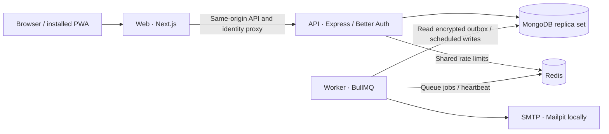

<div align="center">
  <h1>FinSight</h1>
  <p><strong>Money, with perspective.</strong></p>
  <p>An India-first personal finance workspace for accounts, spending, budgets and savings,<br />built on exact paise, Indian number formatting and an April financial year.</p>
  <p>
    <a href="https://github.com/Thippeswamykr1204/FinSight/actions/workflows/quality.yml"></a>
    <a href="https://github.com/Thippeswamykr1204/FinSight/actions/workflows/codeql.yml"></a>
    <a href="LICENSE"></a>
    <a href="package.json"></a>
    <a href="package.json"></a>
    <a href="package.json"></a>
  </p>
</div>

<table>
  <tr>
    <td width="50%"></td>
    <td width="50%"></td>
  </tr>
</table>

<!-- Live demo: add the public URL here once the API, worker, database, Redis and SMTP are deployed. -->

## Overview

FinSight brings manually maintained accounts, transactions, budgets and savings
goals into a private, server-backed workspace for individuals and small groups
that share records through role-controlled access. New workspaces start empty;
every insight is calculated from the activity you record.

India-first conventions live in the shared domain, not just in the display layer:

| Convention       | Implementation                                                                                 |
| ---------------- | ---------------------------------------------------------------------------------------------- |
| Exact money      | Integer paise throughout the ledger (₹123.45 is `12345`); decimal input is parsed with BigInt. |
| Familiar numbers | INR with `en-IN` grouping (`₹1,00,000`); compact values use lakh (`L`) and crore (`Cr`).       |
| Local dates      | ISO calendar dates in storage, `Asia/Kolkata` for scheduling, `DD/MM/YYYY` in the interface.   |
| Financial year   | April 1 to March 31, with financial-year cash-flow summaries.                                  |

## Key capabilities

- **Ledger:** accounts, transactions with CSV export and version-checked edits, monthly budgets,
  savings goals, recurring records, and CSV/OFX statement import with duplicate detection.
- **Insight:** cash-flow charts, category breakdowns, an explainable planning score,
  3/6/12-month scenarios, and EMI, SIP and goal calculators that state their assumptions.
- **Collaboration:** Owner, Admin, Editor and Viewer roles enforced by the API, expiring
  single-use invitations, workspace switching, plan-based seat limits and an audit log.
- **Account security:** verified email, Argon2id passwords, passkeys, TOTP with recovery codes,
  magic links, device review with remote sign-out, and optional Google sign-in.
- **Data rights:** personal and workspace JSON export, workspace and account deletion, and
  operator privacy and grievance contacts.
- **Billing (optional):** Razorpay subscriptions for Pro and Business, GST invoices, signed
  webhooks and reconciliation. A deployment with no billing variables runs Free only.
  See [billing](docs/BILLING.md).
- **Experience:** responsive layout, command palette, light and dark themes, and an installable
  PWA whose service worker caches recovery assets only, never financial pages or API responses.

## Architecture



The web owns presentation and proxy routing. The API owns identity, authorization and
persistence. The worker delivers outbox email, runs recurring records and reconciles
billing. Shared code owns finance calculations and Zod contracts. Ledger writes combine
replica-set transactions, workspace revisions, idempotency keys and audit events.
Details are in [architecture](docs/ARCHITECTURE.md).

| Location              | Responsibility                                                        |
| --------------------- | --------------------------------------------------------------------- |
| `apps/web/`           | Next.js routes, components, themes, PWA assets and the API proxy      |
| `apps/api/`           | Express, Better Auth, Mongoose models, services, worker and API tests |
| `packages/shared/`    | INR arithmetic, calendars, calculators, imports and shared contracts  |
| `tests/` · `scripts/` | Unit and browser tests; environment, preflight, e2e and rekey scripts |
| `docs/` · `ops/`      | Documentation; Caddy HTTPS proxy configuration                        |

| Layer             | Technology                                                         |
| ----------------- | ------------------------------------------------------------------ |
| Web               | Next.js 15 (App Router), React 18, Tailwind CSS 4, Recharts        |
| API               | Express 5, Zod, Better Auth with passkeys, Argon2                  |
| Data and queues   | MongoDB 8 via Mongoose, Redis 7 via ioredis, BullMQ                |
| Email and logging | Nodemailer, Pino                                                   |
| Quality           | TypeScript 5, Vitest, Playwright, Testcontainers, ESLint, Prettier |

## Quick start

Requirements: Node.js 22.12 or newer, npm, and Docker with Compose v2.

```sh
git clone https://github.com/Thippeswamykr1204/FinSight.git
cd FinSight
npm ci
npm run env:init                       # creates .env with unique local secrets
docker compose up --build -d --wait    # web, API, worker, MongoDB, Redis, Mailpit
```

| Open                                                    | Purpose                                          |
| ------------------------------------------------------- | ------------------------------------------------ |
| [localhost:3000/sign-up](http://localhost:3000/sign-up) | Create an account and onboard an empty workspace |
| [localhost:8025](http://localhost:8025)                 | Mailpit inbox for verification and reset emails  |
| [localhost:4000/ready](http://localhost:4000/ready)     | API readiness (MongoDB and Redis)                |

Stop with `docker compose down`; `docker compose down -v` also erases local data.

To develop with live reload, stop the web and API containers and run them from source:

```sh
docker compose stop web api
npm run shared:build
npm run dev:hosted
```

## Configuration

`npm run env:init` creates a private `.env` from [`.env.example`](.env.example). The
essentials for any deployment:

| Variable                                          | Purpose                                                      |
| ------------------------------------------------- | ------------------------------------------------------------ |
| `NODE_ENV`, `HOSTED_LOCAL`                        | `production` and `false` for any public deployment           |
| `WEB_ORIGIN`, `API_ORIGIN`, `NEXT_PUBLIC_APP_URL` | Public HTTPS origins (the last is compiled in at build time) |
| `API_URL`                                         | Where the web service reaches the API                        |
| `MONGODB_URI`, `REDIS_URL`                        | Authenticated replica set; TLS Redis with `noeviction`       |
| `BETTER_AUTH_SECRET`, `FIELD_ENCRYPTION_KEY`      | Generated secrets (see [key rotation](docs/KEY_ROTATION.md)) |
| `SMTP_*`, `EMAIL_FROM`                            | Transactional email provider and verified sender             |
| `PRIVACY_CONTACT_EMAIL`, `GRIEVANCE_OFFICER_NAME` | Real operator contacts, required to boot in production       |
| `TRUSTED_PROXY`                                   | Explicit proxy address allowlist for client-IP rate limits   |

Google sign-in, Razorpay billing and Sentry are optional groups documented in
`.env.example`. Validate any production environment before deploying:

```sh
npm run preflight -- --env-file path/to/production.env
```

## Quality

```sh
npm run format:check
npm run check          # lint, typecheck, coverage, API tests, integration tests, build
E2E_PRODUCTION=1 npm run test:e2e   # browser flows; needs Docker, Chromium and a prior build
```

CI runs formatting, lint, types, coverage thresholds, integration and browser tests, dependency
audits, a container readiness smoke test, CodeQL, dependency review, secret scanning and
container vulnerability scanning. Unit tests cover money, calendars, imports, planning,
recurrence, billing, configuration, encryption and provider signatures; integration tests
exercise real replica-set writes, tenant boundaries, quotas and deletion.

## Deployment

Deploy the web, API and worker as separate processes from one release. MongoDB must be a
replica set; Redis backs rate limits, queues and worker heartbeats; a transactional SMTP
provider is required for authentication email.

| Target                 | Support in this repository                                           |
| ---------------------- | -------------------------------------------------------------------- |
| Render                 | `render.yaml` blueprint for web, API and worker                      |
| Railway                | `railway.web.json`, `railway.api.json`, `railway.worker.json`        |
| Docker Compose + Caddy | `compose.production.yaml` with hardened services and `ops/Caddyfile` |
| Vercel (web only)      | `vercel.json`; API and worker still run on long-lived services       |

Start with the [deployment guide](docs/DEPLOYMENT.md), keep the [runbook](docs/RUNBOOK.md)
for day-two operations, and complete the [launch checklist](docs/LAUNCH_CHECKLIST.md).
Tagged releases (`vX.Y.Z`) publish container images with provenance and an SBOM.

## Security and privacy

- Argon2id passwords, server-verified sessions, role-scoped operations and fresh sign-in for
  destructive actions.
- AES-256-GCM, purpose-bound and rotatable keys protect email bodies, billing profiles and
  invoice party snapshots.
- Shared Redis rate limits, input validation, origin checks, HttpOnly and SameSite cookies, CSP,
  frame denial and HSTS.
- Financial data is excluded from service-worker caching; logs redact credentials; optional
  Sentry capture excludes financial and request payloads.
- DPDP-aware notice acceptance and data-rights flows support compliance. The deployment
  operator owns the applicable legal and retention processes.

Read the [security notes](docs/SECURITY.md) (including known limitations) and report
vulnerabilities privately as described in [SECURITY.md](SECURITY.md).

## Project status

FinSight is under active development. The Free plan works without payment credentials and is the
recommended launch configuration. Razorpay billing and Google sign-in are implemented and covered by
unit and integration tests, but have not yet been verified end to end against live provider
accounts; the remaining checks are listed in the [launch checklist](docs/LAUNCH_CHECKLIST.md).
No production deployment, uptime figure or compliance certification is claimed.

## Documentation

| Document                                     | Covers                                               |
| -------------------------------------------- | ---------------------------------------------------- |
| [Architecture](docs/ARCHITECTURE.md)         | Service boundaries, persistence, worker duties       |
| [API](docs/API.md)                           | Routes, roles, finance commands, billing contract    |
| [India domain](docs/INDIA.md)                | Paise, INR formatting, IST, financial years, imports |
| [Billing](docs/BILLING.md)                   | Plans, GST, Razorpay lifecycle, retention, Google    |
| [Security](docs/SECURITY.md)                 | Controls, secrets, known limitations                 |
| [Key rotation](docs/KEY_ROTATION.md)         | Encryption envelopes, retained keys, rekeying        |
| [Deployment](docs/DEPLOYMENT.md)             | Topologies, hosting, HTTPS, proxy trust, backups     |
| [Runbook](docs/RUNBOOK.md)                   | Alerts, rollback, restore, incident response         |
| [Launch checklist](docs/LAUNCH_CHECKLIST.md) | Verified scope and operator-dependent checks         |
| [Visual QA](docs/VISUAL_QA.md)               | Visual review guidance and screenshots               |
| [Changelog](CHANGELOG.md)                    | Notable changes                                      |

## Contributing

Contributions are welcome. Read [CONTRIBUTING.md](CONTRIBUTING.md) for setup, conventions and the
checks a pull request must pass.

## License

[MIT](LICENSE) · Copyright © 2026 Thippeswamy.