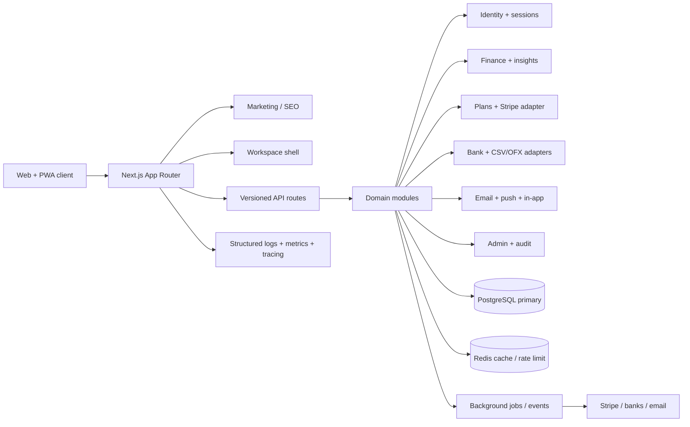

# FinSight v2 build plan

## Product thesis

FinSight is a calm financial operating system for people who want the confidence of knowing what changed, what is safe to spend, and what to do next. The product should feel like a clear morning briefing rather than a spreadsheet: dense where it earns attention, quiet everywhere else.

## Design direction

- **Signature:** the “Pulse” ribbon — a thin, animated current-month cash-flow line that appears in the shell and dashboard, connecting the headline balance to the detail below.
- **Palette:** ink `#101416`, canvas `#F5F7F6`, cloud `#EEF2F0`, signal mint `#B8F2D0`, cobalt `#4C6FFF`, ember `#F18D63`, and muted sage `#7A8B84`.
- **Type:** Geist for utility and body copy; Fraunces for a restrained editorial display voice on marketing/empty-state moments; tabular numerals for financial data.
- **Layout:** wide breathing room, high-contrast scorecards, asymmetrical dashboard split, compact dense rows for money movement, and a mobile bottom rail.
- **Motion:** one orchestrated entry reveal, chart draw-in, number tween, deliberate hover lift, and reduced-motion fallbacks.

## Stack choice

- **Web:** Next.js 15.5.27 App Router + React 18 + TypeScript. The vulnerable v14 baseline was upgraded. Server-rendered marketing and an interactive product shell stay in one deployable unit. Turbopack is used for development after the webpack dev server produced an intermittent cold-start hydration failure.
- **Styling:** Tailwind CSS plus CSS variables in a local design-token layer. This is faster to evolve than a third-party theme and keeps the signature visual language owned by FinSight.
- **Data:** The verified demo uses a Zod-validated, browser-persisted ledger with integer minor-unit amounts. Prisma/PostgreSQL code is retained behind a disabled legacy API; workspace isolation and production persistence are a separate unfinished migration. The demo never silently falls back from live data to sample data.
- **Charts:** Recharts for accessible responsive charts with custom wrappers and tooltip content.
- **Validation:** Zod at API boundaries and shared TypeScript domain types.
- **Caching/jobs (planned):** retain Redis for the future hosted cache and rate limiter. Add durable jobs and an outbox before integrating bank webhooks or email digests; those interfaces are not implemented yet.
- **Auth/billing/connectivity (planned):** implement provider adapters for managed auth, Stripe, bank aggregation, transactional email, and web push. Demo mode currently works without provider credentials and has no live connection to these services.
- **Quality:** ESLint, TypeScript strict mode, Vitest domain tests with coverage thresholds, Playwright critical flows, axe accessibility checks, security headers, and health checks. Docker Compose, CI and operational documentation follow in the delivery checkpoint.

## Architecture



## Target folder tree

```text
src/
  app/
    (marketing)/       landing, pricing, features, FAQ, legal
    (auth)/             login, signup, verify, recovery
    (app)/              dashboard, transactions, budgets, goals, insights
    (settings)/         profile, security, billing, connections, data
    admin/              users, subscriptions, flags, audits
    api/v1/             versioned public/internal API
  components/
    app-shell/          sidebar, mobile rail, command palette, notifications
    charts/             chart primitives and tooltip patterns
    finance/            account, transaction, budget, goal views
    marketing/          sections, pricing, social proof, FAQ
    ui/                 buttons, cards, inputs, dialogs, data states
  lib/
    domain/             finance, workspaces, entitlements, notifications
    adapters/            auth, bank, stripe, email, storage
    db/                  Prisma client, repositories, seed helpers
    security/            headers, audit, rate limit, encryption
    analytics/           events, funnels, attribution
  types/                shared domain and API types
prisma/                 schema, migrations, seed data
docs/                   review, plan, progress, security, operations
infra/                  Docker, CI, Terraform starter configuration
```

## Phases

- [x] **Phase 0 — Baseline review:** inspect the repository, record strengths/gaps, and capture the initial toolchain failure caused by missing installed dependencies.
- [x] **Phase 1 — Foundation:** install dependencies, establish a clean design-token layer, introduce the responsive app shell, metadata, error/loading states, PWA assets, and public route structure.
- [x] **Phase 2 — Product core:** rebuild dashboard, transactions, budgets, insights, goals, net worth, and forecast surfaces with shared persistent demo state, real CSV/OFX import/export, interactive chart ranges, filters, reduced-motion support, keyboard support, and mobile layouts. Verified in development and production-mode Chromium; 10 unit tests and 6 end-to-end tests pass. This is a working demo milestone, not a hosted SaaS launch.
- [ ] **Phase 3 — Activation and monetization:** onboarding, local settings, planned pricing cards, import center, in-app notifications, and keyboard command palette are implemented. Remaining: authenticated workspaces, household membership/RBAC, real email/password/OAuth/magic-link/passkey/TOTP auth, sessions, Stripe checkout/portal/webhooks, trials, entitlements and usage enforcement, live bank adapters, and hosted export/deletion workflows.
- [ ] **Phase 4 — SaaS readiness:** add versioned API foundations, audit/admin views, event model, security headers, GDPR self-service surfaces, API docs, health checks, Docker Compose, CI, and operational artifacts.
- [ ] **Phase 5 — Verification and launch:** run lint, typecheck, build, dev smoke test, accessibility and responsive checks; fix all failures; update README, progress, launch checklist, unit economics, cost estimate, and roadmap.

## Definition of done

Every completed phase must leave the app runnable with `npm run dev`, have complete files without placeholder implementations, preserve demo mode, and include a commit with a clear phase message. Unbuilt production integrations stay clearly marked as pending in this plan; demo interactions must not claim successful billing, bank syncing, email delivery, or hosted persistence.

## Current implemented tree

```text
src/app/                     public pages and finance routes
src/components/finance/      persistent provider, accessible forms, lazy chart
src/components/layout/       responsive shell, command palette, PWA registration
src/components/marketing/    shared public navigation and footer
src/lib/finance/             validated ledger, seed, calculations, CSV/OFX parser
src/lib/                     retained legacy API helpers
src/middleware.ts            disabled-by-default legacy API gate
tests/unit/                  domain and import/export invariants
tests/e2e/                   browser workflows, accessibility, API gate checks
public/                      service worker and offline recovery page
```
