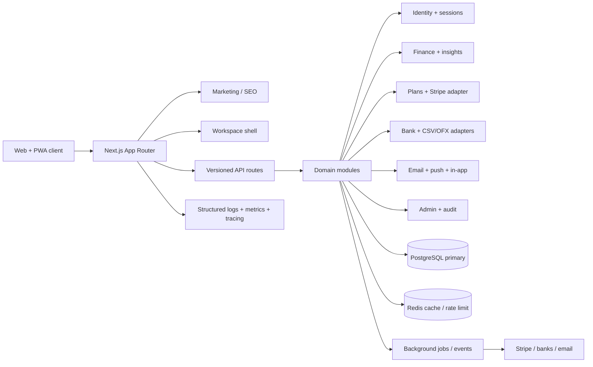

# FinSight v2 build plan

## Product thesis

FinSight is a calm financial operating system for people who want the confidence of knowing what changed, what is safe to spend, and what to do next. The product should feel like a clear morning briefing rather than a spreadsheet: dense where it earns attention, quiet everywhere else.

## Design direction

- **Signature:** the “Pulse” ribbon — a thin, animated current-month cash-flow line that appears in the shell and dashboard, connecting the headline balance to the detail below.
- **Palette:** ink `#101416`, canvas `#F5F7F6`, cloud `#EEF2F0`, signal mint `#B8F2D0`, cobalt `#4C6FFF`, ember `#F18D63`, and muted sage `#7A8B84`.
- **Type:** Geist for utility and body copy; Fraunces for a restrained editorial display voice on marketing/empty-state moments; tabular numerals for financial data.
- **Layout:** wide breathing room, high-contrast scorecards, asymmetrical dashboard split, compact dense rows for money movement, and a mobile bottom rail.
- **Motion:** one orchestrated entry reveal, chart draw-in, number tween, deliberate hover lift, and reduced-motion fallbacks.

## Stack choice

- **Web:** Next.js 14 App Router + React 18 + TypeScript. This keeps server-rendered marketing/SEO and an interactive product shell in one deployable unit.
- **Styling:** Tailwind CSS plus CSS variables in a local design-token layer. This is faster to evolve than a third-party theme and keeps the signature visual language owned by FinSight.
- **Data:** Prisma + PostgreSQL, migrating toward workspace-scoped decimal money values and explicit provider/account entities. Existing aggregation and import code is retained where it is correct and moved behind domain boundaries.
- **Charts:** Recharts for accessible responsive charts with custom wrappers and tooltip content.
- **Validation:** Zod at API boundaries and shared TypeScript domain types.
- **Caching/jobs:** Redis adapter with graceful local fallback; the job/event interfaces are defined now so provider webhooks and digest jobs can be added without coupling pages to infrastructure.
- **Auth/billing/connectivity:** provider interfaces for Auth.js/managed auth, Stripe, Plaid/TrueLayer-style aggregation, transactional email, and web push. Demo mode works without any provider credentials.
- **Quality:** ESLint, TypeScript strict mode, Vitest-ready unit boundaries, Playwright-ready critical flows, Docker Compose, GitHub Actions, security headers, health checks, and operational docs.

## Architecture



## Target folder tree

```text
src/
  app/
    (marketing)/       landing, pricing, features, FAQ, legal
    (auth)/             login, signup, verify, recovery
    (app)/              dashboard, transactions, budgets, goals, insights
    (settings)/         profile, security, billing, connections, data
    admin/              users, subscriptions, flags, audits
    api/v1/             versioned public/internal API
  components/
    app-shell/          sidebar, mobile rail, command palette, notifications
    charts/             chart primitives and tooltip patterns
    finance/            account, transaction, budget, goal views
    marketing/          sections, pricing, social proof, FAQ
    ui/                 buttons, cards, inputs, dialogs, data states
  lib/
    domain/             finance, workspaces, entitlements, notifications
    adapters/            auth, bank, stripe, email, storage
    db/                  Prisma client, repositories, seed helpers
    security/            headers, audit, rate limit, encryption
    analytics/           events, funnels, attribution
  types/                shared domain and API types
prisma/                 schema, migrations, seed data
docs/                   review, plan, progress, security, operations
infra/                  Docker, CI, Terraform starter configuration
```

## Phases

- [x] **Phase 0 — Baseline review:** inspect the repository, record strengths/gaps, and capture the initial toolchain failure caused by missing installed dependencies.
- [x] **Phase 1 — Foundation:** install dependencies, establish a clean design-token layer, introduce the responsive app shell, metadata, error/loading states, PWA assets, and public route structure.
- [ ] **Phase 2 — Product core:** rebuild dashboard, transactions, budgets, insights, goals, net worth, and forecast surfaces with interactive charts, filters, animations, keyboard support, and mobile layouts.
- [ ] **Phase 3 — Activation and monetization:** ship onboarding, workspace switcher, settings, plan cards, feature gates, billing placeholder flows, connection/import center, notifications, global search, and command palette.
- [ ] **Phase 4 — SaaS readiness:** add versioned API foundations, audit/admin views, event model, security headers, GDPR self-service surfaces, API docs, health checks, Docker Compose, CI, and operational artifacts.
- [ ] **Phase 5 — Verification and launch:** run lint, typecheck, build, dev smoke test, accessibility and responsive checks; fix all failures; update README, progress, launch checklist, unit economics, cost estimate, and roadmap.

## Definition of done

Every phase must leave the app runnable with `npm run dev`, have complete files without placeholders or TODO markers, preserve demo mode, and include a commit with a clear phase message. Production integrations remain behind explicit environment-backed adapters so a clean local checkout can still demonstrate the product.
